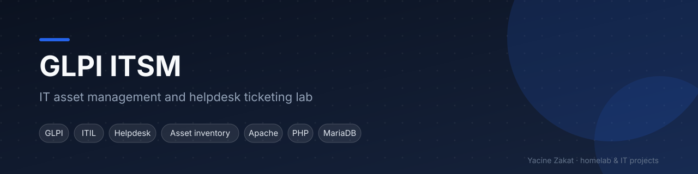
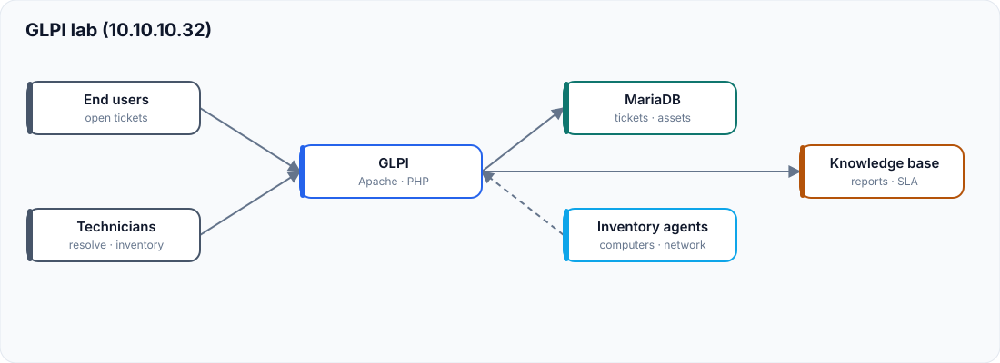

# GLPI – IT Asset & Helpdesk Platform

A GLPI lab used to practise IT service management the way a support team does it: tickets, SLAs, asset inventory and a knowledge base.

| | |
|---|---|
| **Status** | Lab project (not currently running) |
| **Stack** | GLPI · Apache · PHP · MariaDB · Linux |
| **Related** | [Proxmox homelab](https://github.com/bugHunte3R/Proxmox) |

## Architecture

## What I practised

| Area | Details |
|---|---|
| Helpdesk | Incident vs. request, categories, priorities, SLA targets, escalation, closure notes — [docs/helpdesk.md](docs/helpdesk.md) |
| Assets | Computers, monitors, printers, network devices, lifecycle from purchase to disposal — [docs/asset-management.md](docs/asset-management.md) |
| Inventory | Automatic inventory with agents, software and licence tracking — [docs/inventory.md](docs/inventory.md) |
| Users & groups | Profiles, entities, technician groups, least privilege — [docs/users-groups.md](docs/users-groups.md) |
| Operations | Backups, updates, maintenance — [docs/backup.md](docs/backup.md) · [docs/maintenance.md](docs/maintenance.md) |

Flows: [ticket lifecycle](diagrams/ticket-flow.md) · [asset lifecycle](diagrams/asset-lifecycle.md). Templates: [examples/](examples/).

## Fictional addressing used in this repository

| Role | Address |
|---|---|
| GLPI server | `10.10.10.32` |
| Homelab network | `10.10.10.0/24` |

## Skills demonstrated

ITIL-oriented ticket management · IT asset lifecycle · inventory · user and permission management · Apache/PHP/MariaDB · documentation

---
**Yacine Zakat** — IT Support & Application Support Technician
